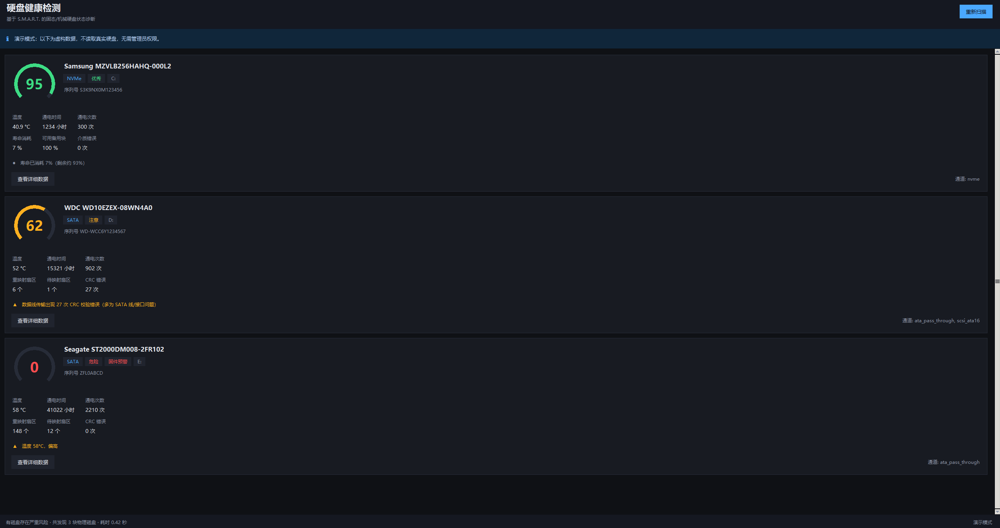

# DiskHealth

**Read your drives' S.M.A.R.T. data on Windows, get a health score, and see the
reasoning in plain language.**


English · [中文说明](README.zh-CN.md)



DiskHealth is a small Windows-only diagnostic tool written in **pure Python, standard
library only**. It talks to the native Windows IOCTL interfaces directly — NVMe log
page `0x02`, ATA PASS-THROUGH, SCSI ATA PASS-THROUGH (16) — scores each drive, and
explains the verdict the way a person would say it. The interface is in Chinese; the
code, this README and the comments are readable either way.

No third-party packages. No network code. No telemetry.

---

## Why another S.M.A.R.T. tool?

Three constraints shaped the design, and they explain most of the code:

- **No external binary.** Bundling `smartctl` would pull a GPL binary into every
  distribution and force an out-of-process call. DiskHealth talks to the kernel
  itself, in a few hundred lines of `ctypes`.
- **No dependencies.** `tkinter` and `ctypes` ship with Python. Clone the repo, run
  `python app.py`, done — no `pip install`.
- **No network, ever.** Not "no analytics for now": there is no HTTP client in the
  repository, and CI fails the build if anyone adds one.

## Privacy and security

This section comes first because a tool that asks for administrator rights and reads
your hardware should say what it does before it does it.

**No network.** The repository contains no `socket`, `urllib`, `requests` or
`http.client`. No auto-update, no crash reporting, no account system, no telemetry.
You can check it yourself:

```powershell
Select-String -Path .\*.py, .\core\*.py, .\ui\*.py -Pattern 'socket|urllib|requests|http'
# expected: no output
```

**No writes to disk.** The only ATA command issued is `0xB0` (SMART) with feature
`0xD0` (SMART READ DATA). The SCSI path uses ATA PASS-THROUGH (16) with `T_DIR=1`,
i.e. data flows *from* the device. There is no write path in the program.

**No system changes.** No registry access, no services, no scheduled tasks, no
startup entries.

**One file written.** `launch.log` — in the project directory when running from
source, in `%LOCALAPPDATA%\DiskHealth\` when frozen. Started via `pythonw.exe` there
is no console, so that log is the only way to see what went wrong.

### About the administrator prompt

Windows only lets administrators open a physical disk and read S.M.A.R.T. That is an
operating-system boundary, not something this program invented. DiskHealth requests
elevation once at startup and then only reads.

The device handle is opened with read+write access first and falls back to read-only,
because some controllers and drivers reject ATA PASS-THROUGH on a read-only handle.
That is a compatibility workaround, not an intention to write — see the command list
above. If you only want to see the interface, `--demo --no-elevate` needs no
administrator rights at all.

## Features

| | |
| --- | --- |
| **Health score** | 0–100 ring gauge. Excellent ≥90 / Good ≥75 / Caution ≥50 / Critical <50 |
| **Per-drive card** | Model, serial, bus type, drive letter, six key metrics |
| **Verdict** | A plain sentence, e.g. "6 sectors have been remapped to spare sectors" |
| **Raw attributes** | Full S.M.A.R.T. attribute table (ID / value / worst / raw) |
| **Firmware override** | A `S.M.A.R.T. FAILED` flag is not averaged in — it forces the score to 15 and turns the card red |
| **Volume mapping** | Maps `PhysicalDriveN` back to `C:`, `D:`, … |

## Quick start

Windows 10/11, and a Python 3 with `tkinter` (included in the official installer).
Nothing else — no `pip install`.

```powershell
# Fake data, no administrator rights needed
python app.py --demo --no-elevate

# Real scan; triggers a UAC prompt
python app.py

# Start unelevated, elevate from inside the UI
python app.py --no-elevate

# Build the UI, print results, exit — used by CI
python app.py --selftest
```

## How it works

The program tries each channel in turn; the first one that answers wins:

| Channel | Drives | IOCTL |
| --- | --- | --- |
| NVMe Health Log (Page 0x02) | NVMe SSD | `IOCTL_STORAGE_QUERY_PROPERTY` |
| ATA PASS-THROUGH | SATA/ATA | `IOCTL_ATA_PASS_THROUGH` |
| SMART_RCV_DRIVE_DATA | SATA/ATA | legacy `SMART_RCV_DRIVE_DATA` |
| SCSI ATA PASS-THROUGH 16 | USB enclosures | `IOCTL_SCSI_PASS_THROUGH_DIRECT` |
| Predict Failure | all | `IOCTL_STORAGE_PREDICT_FAILURE` |

Several channels is not padding. USB bridges, older drivers and virtual disks disagree
about which IOCTL they honour; when one path fails the next one often returns data.

Scoring is not "sum the attribute values". `core/health.py` keeps two rule sets:

- **ATA** looks at attributes 5 (reallocated sectors), 187 (reported uncorrectable),
  197 (current pending), 198 (offline uncorrectable) and 194 (temperature), grading on
  *whether something happened*, not on the magnitude of the number.
- **NVMe** looks at spare capacity, percentage used, media errors and unsafe shutdowns.
- When the firmware reports `FAILED`, the score is not computed at all — it is pinned
  to 15. The drive's own firmware saying no is the strongest signal there is.

## Project structure

```
DiskHealth/
├─ app.py                 # entry point: elevation, demo data, logging, error handling
├─ core/
│  ├─ smart_engine.py     # acquisition: ctypes → DeviceIoControl
│  └─ health.py           # scoring: separate ATA and NVMe rule sets
├─ ui/
│  └─ app_ui.py           # tkinter UI: drive cards, ring gauge, attribute table
├─ docs/
│  └─ screenshot.png
└─ assets/
   ├─ icon.ico
   └─ make_icon_new.py    # icon generator (optional, needs Pillow)
```

## Known limitations

1. **No thresholds.** Reading the "worst threshold" requires a separate
   `SMART READ THRESHOLDS (0xD1)` command, which is not implemented yet. Scoring uses
   fixed rules instead of "how far from the threshold".
2. **Vendor-specific raw values.** Seagate, WD, Samsung and Toshiba pack attributes 5,
   9, 12, 197 and 198 differently, and temperature/lifetime live in different places.
   The parser follows the common conventions; some models may need adapting.
3. **RAID / Intel RST.** Drives behind a controller cannot be addressed directly and
   show up as "unreadable".
4. **USB enclosures.** Some bridge chips (older JMicron firmware especially) swallow
   SCSI ATA PASS-THROUGH.
5. **No history.** No SQLite yet, so past scans are not stored and there are no trend
   charts.
6. **Unsigned.** A self-built `.exe` triggers SmartScreen. That is what unsigned
   binaries do, not a defect.

## Troubleshooting

Started with `pythonw.exe` there is no console, so the whole startup sequence goes to
`launch.log`:

```
[2026-09-19 13:39:14] launcher v1  argv=[]
[2026-09-19 13:39:14] administrator = True
[2026-09-19 13:39:14] main window created, entering event loop
```

The elevated instance is a **separate process**, and it appends to the same log, so you
will see both processes in one file (distinguished by pid). That is usually the most
useful thing when debugging.

## License

[Apache License 2.0](LICENSE). Use it, modify it, ship it commercially — keep the
copyright and license notice.

Provided **as is**. A health score is a hint, not a guarantee: **keep backups either
way.**
