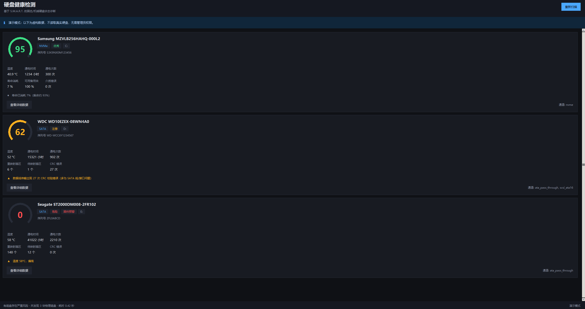

# 硬盘健康检测 · DiskHealth

**在 Windows 上直接读硬盘的 S.M.A.R.T.，给出健康分，并用普通话讲清楚问题在哪。**


[English](README.md) · 中文



纯 Python 标准库 + Windows 原生 IOCTL，**不联网、无遥测、零第三方依赖**。
界面是中文的；代码、注释和这两份 README 都可以直接读。

---

## 为什么还要再写一个

三个约束决定了大部分代码长什么样：

- **不调用外部程序。** 打包 `smartctl` 会把一个 GPL 二进制塞进每次分发，还得跨进程拿结果。
  DiskHealth 自己调内核接口，几百行 `ctypes` 就够。
- **不引入依赖。** `tkinter` 和 `ctypes` 是 Python 自带的。克隆下来 `python app.py` 就能跑，
  不需要 `pip install` 任何东西。
- **不联网，永远。** 不是"暂时没做统计"，而是仓库里根本没有 HTTP 客户端——
  而且 CI 会在任何人加网络调用时报错。

## 隐私与安全

这一节放在最前面，因为一个要管理员权限、还要读你硬件的程序，应该先把话说清楚。

**不联网。** 仓库里没有 `socket`、`urllib`、`requests`、`http.client`。
没有自动更新、崩溃上报、账号体系，也没有统计。可以自己验证：

```powershell
Select-String -Path .\*.py, .\core\*.py, .\ui\*.py -Pattern 'socket|urllib|requests|http'
# 预期：无输出
```

**不写盘。** 发给磁盘的 ATA 命令只有 `0xB0`（SMART）配特性 `0xD0`（SMART READ DATA）。
SCSI 侧是 ATA PASS-THROUGH (16)，`T_DIR=1`，数据方向是从设备读入。
程序里没有写盘路径。

**不碰系统。** 不读写注册表，不装服务，不建计划任务，不写启动项。

**只写一个文件。** `launch.log`：源码运行时在项目目录，打包后在
`%LOCALAPPDATA%\DiskHealth\`。用 `pythonw.exe` 启动时没有控制台，这个日志是唯一能
看到出错原因的地方。

### 关于管理员权限

Windows 规定只有管理员才能打开物理磁盘、读取 S.M.A.R.T.，这是操作系统的安全边界，
不是本程序多要的。程序启动时请求一次 UAC，拿到权限后只做一件事：读。

打开磁盘句柄时会先请求「读 + 写」，失败后退回只读——这是为了兼容：部分主控/驱动会
拒绝在只读句柄上执行 ATA PASS-THROUGH。这是兼容手段，不是要写盘，上面那份命令清单
就是证据。如果你只想看界面，`--demo --no-elevate` 完全不需要管理员权限。

## 功能

| | |
| --- | --- |
| **健康分** | 0~100 环形仪表盘。优秀 ≥90 / 良好 ≥75 / 注意 ≥50 / 危险 <50 |
| **磁盘卡片** | 型号、序列号、总线类型、盘符、6 项关键指标 |
| **健康结论** | 用一句普通话说明问题，例如「已有 6 个扇区损坏并被备用扇区替换」 |
| **详细数据** | 完整 S.M.A.R.T. 属性表（ID / 当前值 / 最差值 / 原始值） |
| **固件预警** | `S.M.A.R.T. FAILED` 不参与平均——直接把分数压到 15 并标红 |
| **卷映射** | 把 `PhysicalDriveN` 对应回 `C:`、`D:` 等盘符 |

## 快速开始

Windows 10/11，外加一个带 `tkinter` 的 Python 3（官方安装包自带）。除此之外什么都不要。

```powershell
# 假数据看界面，不需要管理员权限
python app.py --demo --no-elevate

# 正式扫描，会弹 UAC
python app.py

# 不提权启动，在界面里自己点提权
python app.py --no-elevate

# 构建界面、打印结果、退出（CI 用）
python app.py --selftest
```

## 采集与评分

程序依次尝试每个通道，任一命中即可：

| 通道 | 适用磁盘 | IOCTL |
| --- | --- | --- |
| NVMe Health Log (Page 0x02) | NVMe SSD | `IOCTL_STORAGE_QUERY_PROPERTY` |
| ATA PASS-THROUGH | SATA/ATA | `IOCTL_ATA_PASS_THROUGH` |
| SMART_RCV_DRIVE_DATA | SATA/ATA | 老式 `SMART_RCV_DRIVE_DATA` |
| SCSI ATA PASS-THROUGH 16 | USB 硬盘盒 | `IOCTL_SCSI_PASS_THROUGH_DIRECT` |
| Predict Failure | 全部 | `IOCTL_STORAGE_PREDICT_FAILURE` |

多个通道不是凑数：USB 桥接芯片、老驱动、虚拟磁盘对同一个 IOCTL 的响应差异很大，
一路不通时下一路往往能拿到数据。

评分不是把属性值加起来。`core/health.py` 里 ATA 与 NVMe 各一套规则：

- **ATA** 看属性 5（重映射扇区）、187（不可纠正错误）、197（待映射扇区）、
  198（离线不可纠正）、194（温度），按「有没有发生过」分级，而不是按数字大小；
- **NVMe** 看可用备用空间、已用寿命百分比、介质错误数、不安全关机次数；
- 固件报 `FAILED` 时不再算分，直接压到 15——固件自己说不行，那就是最硬的信号。

## 项目结构

```
DiskHealth/
├─ app.py                 # 入口：提权、演示数据、日志、异常兜底
├─ core/
│  ├─ smart_engine.py     # 采集层：ctypes 直调 DeviceIoControl
│  └─ health.py           # 评分层：ATA / NVMe 两套规则
├─ ui/
│  └─ app_ui.py           # tkinter 界面：磁盘卡片、环形仪表盘、详情表
├─ docs/
│  └─ screenshot.png
└─ assets/
   ├─ icon.ico
   └─ make_icon_new.py    # 图标生成脚本（可选，需要 Pillow）
```

## 已知限制

1. **没有阈值。** 读「最差阈值」需要额外发 `SMART READ THRESHOLDS (0xD1)`，尚未实现，
   所以现在用固定规则打分，而不是「离阈值还有多远」。
2. **厂商 raw 值差异。** 希捷/西数/三星/东芝对属性 5、9、12、197、198 的封装不同，
   温度与寿命字段的位置也不统一。目前按主流约定解析，个别型号可能需要适配。
3. **RAID / Intel RST。** 控制器后面的磁盘无法直接寻址，会显示为「无法读取」。
4. **USB 硬盘盒。** 部分桥接芯片（尤其 JMicron 老固件）会拦截 SCSI ATA PASS-THROUGH。
5. **没有历史曲线。** 尚未接入 SQLite，不记录历次扫描结果。
6. **没有代码签名。** 自行构建的 exe 会触发 SmartScreen——那是未签名程序的正常表现，
   不是缺陷。

## 排错

用 `pythonw.exe` 启动时没有控制台，所以整个启动过程都写进 `launch.log`：

```
[2026-09-19 13:39:14] 启动器 v1  argv=[]
[2026-09-19 13:39:14] 管理员权限 = True
[2026-09-19 13:39:14] 主窗口已创建，进入事件循环
```

提权后的实例是**另一个进程**，它也会往同一个日志追加，所以日志里会同时出现原始进程和
提权进程的记录（用 pid 区分）——这通常正是排查时最需要的信息。

## 许可

[Apache License 2.0](LICENSE)。可以自由使用、修改、商用，保留版权与许可声明即可。

程序按「现状」提供。健康分是提示，不是保证：**重要数据请始终另外备份。**
